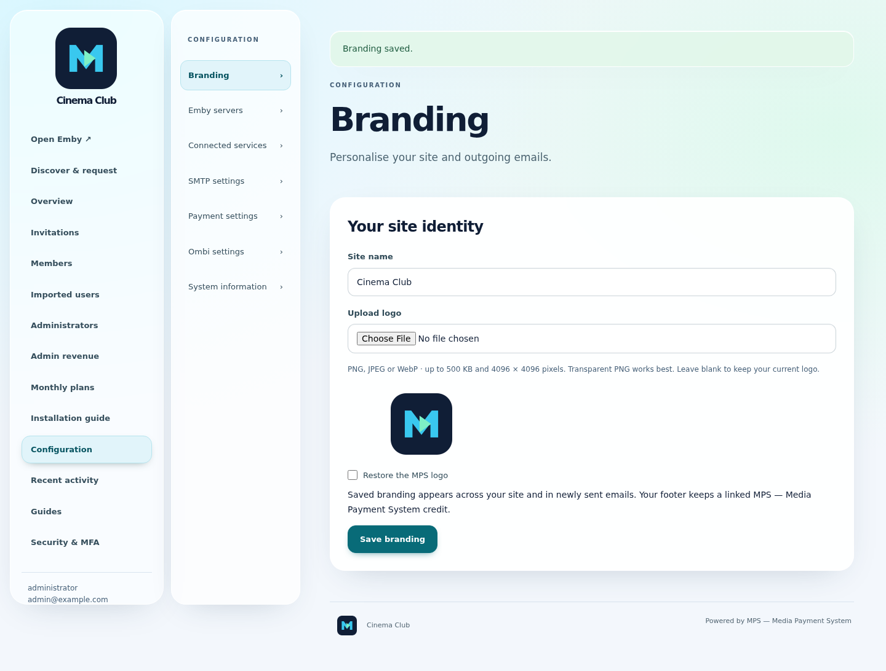
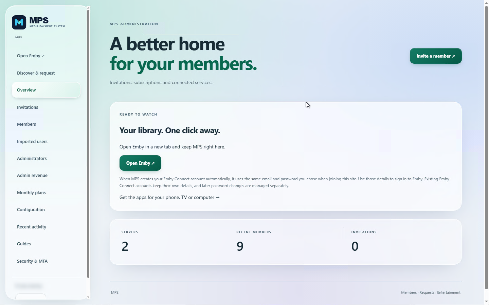
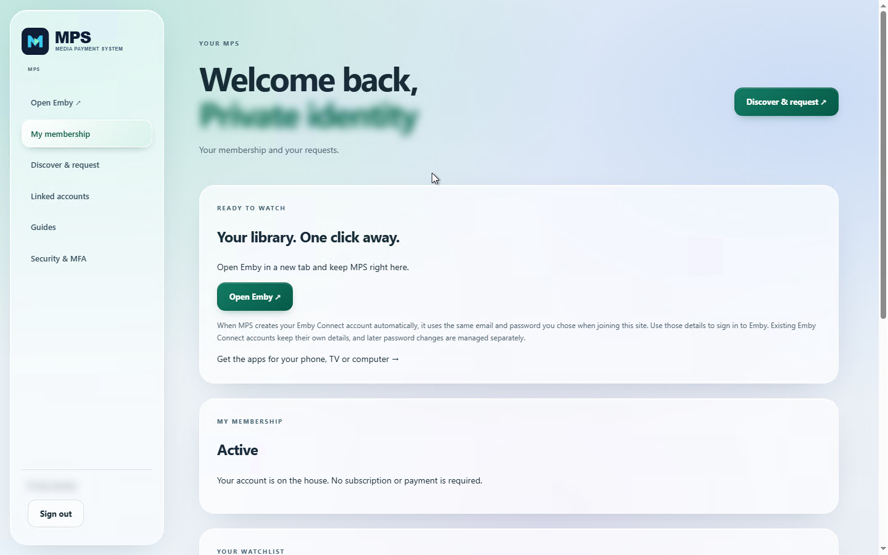
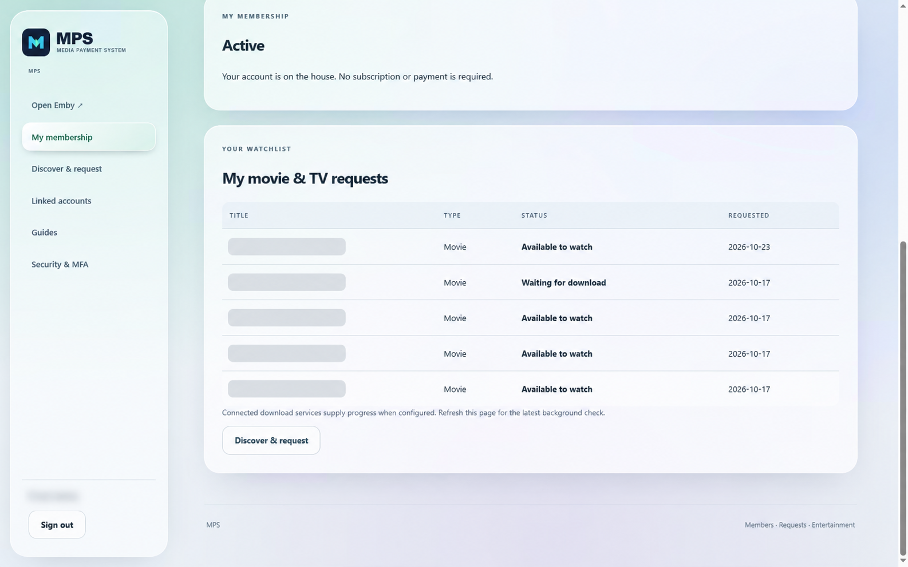

# MPS — Media Payment System

**Self-hosted Emby subscription management, billing and automated user setup for umbrelOS.**

Community App Store · Current release: **1.0.3**

Available through the MPS community app store — separate from the official Umbrel App Store.

## Windows and Linux downloads

**MPS 1.0.3 — installer revision 2** is available now:

- [Windows x64 installer](https://github.com/matty03072/MPS-Media-Payment-System-Store/releases/download/installers-1.0.3-r2/MPS-1.0.3-windows-x64-setup.exe)
- [Ubuntu 24.04 x64 archive](https://github.com/matty03072/MPS-Media-Payment-System-Store/releases/download/installers-1.0.3-r2/MPS-1.0.3-linux-x64.tar.gz)
- [Checksums and installation notes](https://github.com/matty03072/MPS-Media-Payment-System-Store/releases/tag/installers-1.0.3-r2)

Fresh interactive Windows installs offer SQLite, SQL Server or PostgreSQL. Updating an existing installation preserves its database and configuration. Windows is unsigned; Linux requires systemd and CPython 3.12. Back up your complete data folder before updating.

## What is MPS? Emby subscription and payment management

**MPS lets you charge users a recurring subscription for access to your Emby servers, with integrated payments and automatic member account setup.**

Manage Emby subscriptions, payments and connected service accounts from one self-hosted portal. It integrates **Emby, Emby Connect, Ombi, Stripe, PayPal and SMTP email** so administrators can manage invitations, plans, permissions and member access together.

### Automatic setup from one invitation

Once you have configured your connected services, the member completes their invitation and verifies their email. MPS then automatically:

- **Sets up Emby Connect** by creating or linking the member’s account using their signup details.
- **Creates their accounts on the invited Emby servers**, applies the assigned library permissions and links those servers to their Emby Connect account.
- **Creates or links their Ombi account** so they can discover and request content from the portal.

**No routine manual account creation, server linking or Ombi setup is required for each member.** The administrator configures the service connections once; MPS handles the normal member setup automatically.

Access follows the invitation’s permissions and membership/payment requirements. Emby Connect may ask the member to verify their email. Conflicting existing accounts or service errors can require attention; MPS does not bypass those checks.

Members can manage their membership, open Emby and discover/request content through Ombi from the same portal. MPS coordinates the services; it does not replace them or automatically configure the administrator's service connections.

See the installation and public-access limitations below, and the [1.0.3 release notes](docs/RELEASE-1.0.3.md).

## Custom branding

Administrators can open **Configuration → Branding** to upload their logo and set their own site name. The site and new emails use the saved branding, with a linked MPS — Media Payment System credit retained in the footer.



## Screenshots

Live application views with temporary MPS branding; names and emails removed before blurring. No live-site data or configuration is included in the install.

### Administrator overview



### Member dashboard



### Member request statuses



## Install

Choose your platform below. Windows and Linux downloads are **MPS 1.0.3, installer revision 2**.

### Windows x64

1. [Download the Windows installer](https://github.com/matty03072/MPS-Media-Payment-System-Store/releases/download/installers-1.0.3-r2/MPS-1.0.3-windows-x64-setup.exe).
2. Run the EXE as administrator. The installer is unsigned.
3. On a fresh interactive installation, choose **SQLite**, **Microsoft SQL Server** or **PostgreSQL**. External databases must already be provisioned; see the [setup requirements](https://github.com/matty03072/MPS-Media-Payment-System-Store/releases/tag/installers-1.0.3-r2).
4. Open [http://localhost:8099](http://localhost:8099) on the installed computer and follow first-run setup.

For an existing installation, back up the complete data folder and run the new installer over the current copy. It retains the database, configuration and encryption key; it does not switch databases. SQLite normally uses `C:\ProgramData\MPS\data\members.sqlite3`.

### Linux — Ubuntu 24.04 x64

1. [Download the Linux archive](https://github.com/matty03072/MPS-Media-Payment-System-Store/releases/download/installers-1.0.3-r2/MPS-1.0.3-linux-x64.tar.gz). Requires **systemd and CPython 3.12**.
2. Extract the archive, open a terminal in the extracted directory and run:

   ```bash
   sudo bash install.sh
   ```

3. Open [http://localhost:8099](http://localhost:8099) on the installed computer and follow first-run setup.

Back up the complete data folder before updating an existing installation. Standalone installers do not automatically configure a public domain, HTTPS or firewall access.

[Revision 2 release notes and SHA-256 checksums](https://github.com/matty03072/MPS-Media-Payment-System-Store/releases/tag/installers-1.0.3-r2)

### umbrelOS

1. In umbrelOS, open **App Store → Community App Stores** (usually in the
   App Store menu).
2. Add `https://github.com/matty03072/MPS-Media-Payment-System-Store`.
3. Open **MPS — Media Payment System** and install **MPS — Media Payment System**.
4. Open the installed app from Umbrel. Unlock first-run setup with username
   `owner` and the app password shown by Umbrel.
5. Create your permanent owner account and enrol MFA with an authenticator.

## Umbrel deployment information
App ID: `memberspreview-members-portal`. Port: `18099` (must be unused).
Data is separate from any future official app. No live-site configuration,
production database, credentials or member records are included.

Use test integrations only. Default Umbrel authentication protects every route;
public invitations and external payment callbacks are not supported by this
default configuration. An official-store submission is under review; this community store is separate.

Application source is private. This repository contains store packaging, documentation and presentation assets only—not application source.

[Release notes](docs/RELEASE-1.0.3.md) · [Support](https://github.com/matty03072/MPS-Media-Payment-System-Store/issues)

Container checks do not constitute an umbrelOS installation test. The first
install, UI setup/MFA, reboot and backup/restore still need testing on your Umbrel.
Back up the entire app data folder, including all configuration. Do not assume automatic migration to a future production app ID.

## Update Umbrel to 1.0.3

Use **Update** in Umbrel for your existing MPS installation. **Do not uninstall or delete the app to upgrade.** Back up the complete app data folder first. Existing app identity, data locations and licensing terms are unchanged.

## Installation activity

Free and licensed installations periodically report an installation identifier, app version and activity time to the publisher to measure active installations. No member details, media activity or service credentials are included. Reporting failures do not change free-tier access. See the [privacy notice](https://members.streaminghome.app/mps/privacy).

## Connected services

MPS includes Sonarr/Radarr connection settings, member download and import progress, optional Emby library updates and separate service configuration pages. Configure your own services under **Configuration → Connected services**; no live-site credentials are included.

## Application licensing (1.0.3)

Ten enabled media members are free, including administrators with linked media identities. Larger installations require a GBP 5/month
unlock covering three applications. Back up the entire state directory before
updating; keep all existing app data. Without an unlock, excess member records
remain stored but only the ten oldest eligible enabled members retain MPS access.
Excess linked Emby access is disabled on downgrade and restored when licensing
and membership permissions allow it. Direct Ombi access is not disabled by MPS.
Paid access requires an online check after restart.
The existing [MPS no-resale licence](LICENSE) remains unchanged; paid membership operations are permitted. Application source is no longer publicly distributed. Previous licence grants remain unchanged.

[Licensing and upgrade guide](docs/APPLICATION-LICENSING.md).
[Purchase and signed-in support](https://members.streaminghome.app/mps).
Cancellation stops renewal at period end. Requests within 14 days of the latest
payment receive a full refund; paid access remains until period end.
