# MPS — Media Payment System

[Official MPS website](https://mediapaymentsystem.app/) · [Downloads](https://mediapaymentsystem.app/downloads)

**Self-hosted Emby and Jellyfin membership management, billing and automated account setup.**

Community App Store · Current release: **1.0.4**

Available through the MPS community app store — separate from the official Umbrel App Store.

## Windows and Linux downloads

**MPS 1.0.4** is available now:

- [Windows x64 installer](https://github.com/matty03072/MPS-Media-Payment-System-Store/releases/download/installers-1.0.4/MPS-1.0.4-windows-x64-setup.exe)
- [Ubuntu 24.04 x64 archive](https://github.com/matty03072/MPS-Media-Payment-System-Store/releases/download/installers-1.0.4/MPS-1.0.4-linux-x64.tar.gz)
- [Checksums and installation notes](https://github.com/matty03072/MPS-Media-Payment-System-Store/releases/tag/installers-1.0.4)

Fresh interactive Windows installs offer SQLite, SQL Server or PostgreSQL. Updating an existing installation preserves its database and configuration. Windows is unsigned; Linux requires systemd and CPython 3.12. Back up your complete data folder before updating.

## What is MPS? Media subscription and payment management

**MPS manages memberships for your Emby and Jellyfin servers, with optional subscription payments and automated member account setup.**

Manage media access, payments and connected service accounts from one self-hosted portal. It integrates **Emby, Jellyfin, Emby Connect, Ombi, Sonarr, Radarr, Stripe, PayPal and SMTP email** so administrators can manage invitations, plans, permissions and member access together.

### Automatic setup from one invitation

Once you have configured your connected services, the member completes their invitation and verifies their email. MPS then automatically:

- **Creates accounts on the selected Emby and Jellyfin servers**, applies their assigned library and optional Live TV permissions, and shows only their allowed server links.
- **Sets up Emby Connect when Emby access needs it**; Jellyfin uses local server accounts and does not require Emby Connect.
- **Creates or links their Ombi account** so they can discover and request content from the portal.

**No routine manual account creation, server linking or Ombi setup is required for each member.** The administrator configures the service connections once; MPS handles the normal member setup automatically.

Access follows the invitation’s permissions and membership/payment requirements. Emby Connect may ask the member to verify their email. Conflicting existing accounts or service errors can require attention; MPS does not bypass those checks.

Members can manage their membership, open assigned Emby and Jellyfin servers and discover/request content through Ombi from the same portal. MPS coordinates the services; it does not replace them or automatically configure the administrator's service connections.

See the installation and public-access limitations below, and the [1.0.4 release notes](docs/RELEASE-1.0.4.md).

## Custom branding

Administrators can open **Configuration → Branding** to upload their logo and set their own site name. The site and new emails use the saved branding, with a linked MPS — Media Payment System credit retained in the footer.


## Interface gallery

These are AI-edited previews based on an owner installation, not pixel-exact captures of the released customer app. Branding, account details, titles and artwork have been obscured for privacy. Available screens and actions depend on your version, connected services and permissions.

[Member features](#member-features) · [Administrator tools](#administrator-tools)

### Member features

#### Membership dashboard

A personal home page showing membership status and shortcuts to assigned Emby and Jellyfin servers. Members can reach discovery, linked accounts, guides and account-security settings from the sidebar.

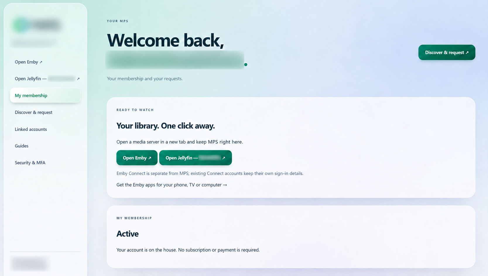

#### Discover and request

Search for movies and TV through a linked Ombi account, manage request email preferences and follow request progress without leaving the portal.

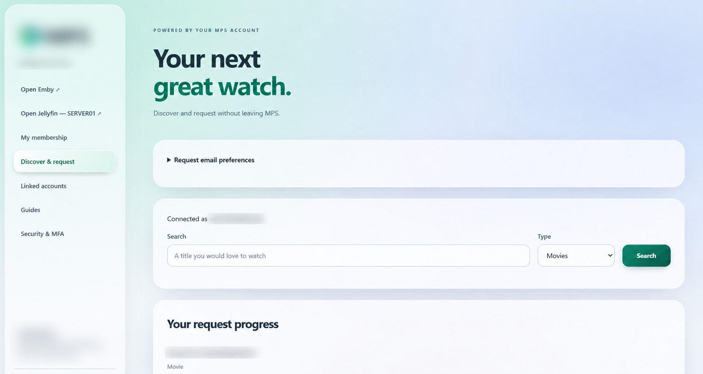

#### Request status and watchlist

See requested titles, media type, request date and progress such as waiting for download, declined or import completed. Availability checks are shown separately, so an import is not presented as confirmed playback availability.

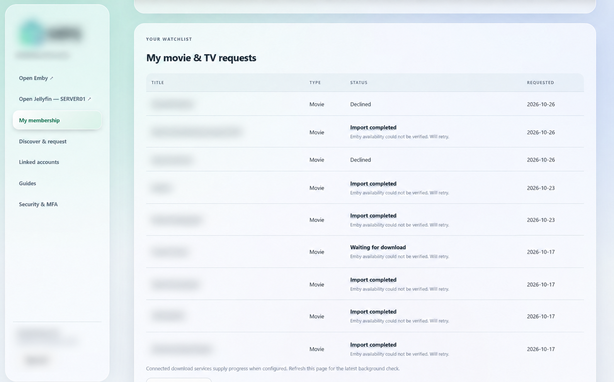

#### Linked service accounts

Review assigned Emby and Jellyfin accounts, setup status, connection state and access. Recheck pending Emby Connect links; Jellyfin uses local server accounts and does not require Emby Connect.

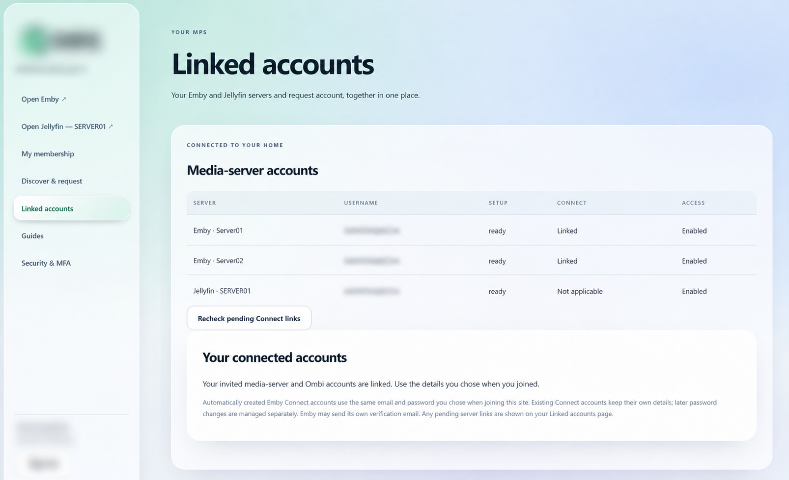

### Administrator tools

#### Administrator overview

A central dashboard for invitations, subscriptions and connected services. See server, recent-member and invitation counts, open media servers and quickly start a member invitation.

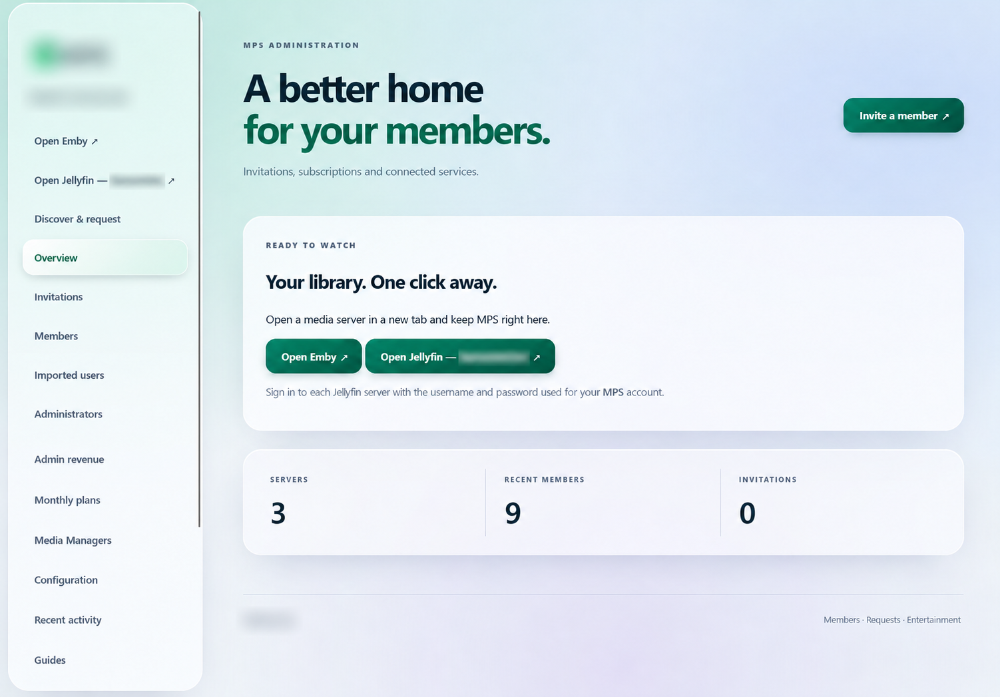

#### Invitations and access permissions

Create invitations with an optional email recipient, expiry, available places and monthly plan. Select Emby or Jellyfin servers, library permissions and optional Live TV access, and choose the administrator credited for resulting revenue.

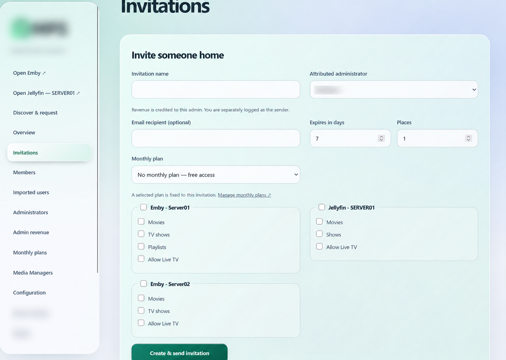

#### Member management

Review member access, billing type, paid-through dates and MFA status in one table. Open individual member management or the account-removal queue for follow-up.

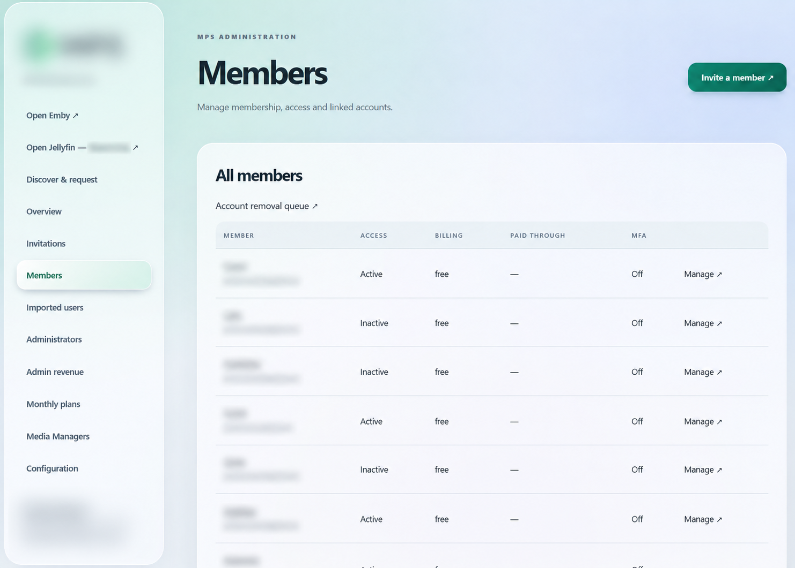

#### Administrator revenue reporting

Filter attributed payments by month and payment environment. Compare paying members, gross collections, refunds or reversals and net receipts by administrator. These are collected-payment reports, not referral commissions.

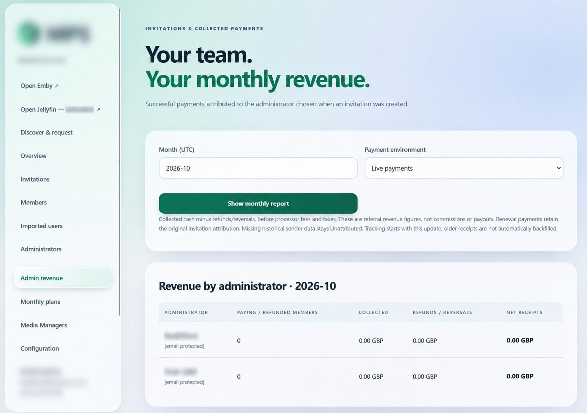

#### Monthly membership plans

Create membership plans, set monthly prices and inspect Stripe and PayPal publication status. Publish plans to configured providers or stop offering a plan on new invitations; saving a plan alone does not publish it.

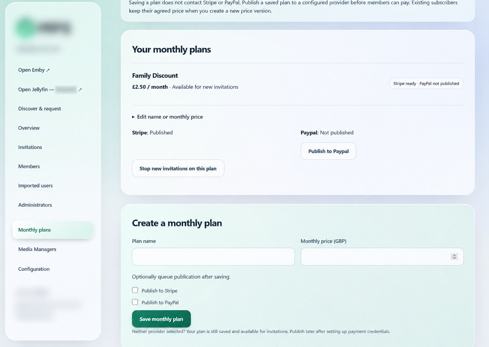

#### Ombi request approvals

Review pending requests from the connected Ombi service and send approval or denial decisions back to Ombi. Refresh the list and open connection settings; this preview shows the empty state when no approvals are waiting.

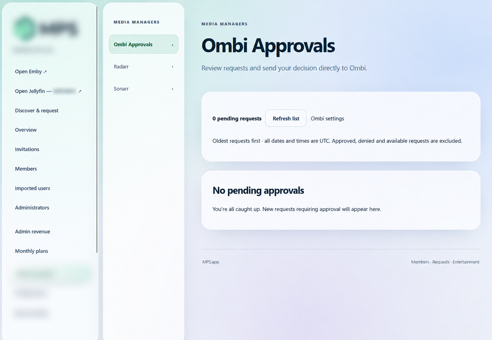

#### Radarr library management

Browse the connected movie library, search, filter and sort titles, and access add-new, activity, queue, calendar and system views. Refresh the library or trigger RSS sync through the integrated Media Managers interface.

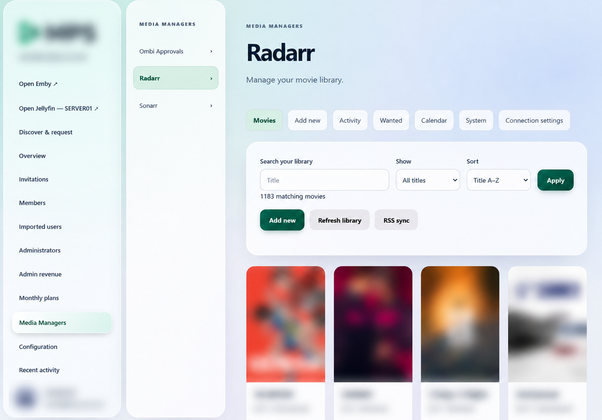

## 1.0.4 interface previews

Captured from a disposable 1.0.4 customer-app fixture with example names and no live service accounts, credentials or customer data. Actual choices depend on your configured services and permissions.

### Jellyfin server configuration

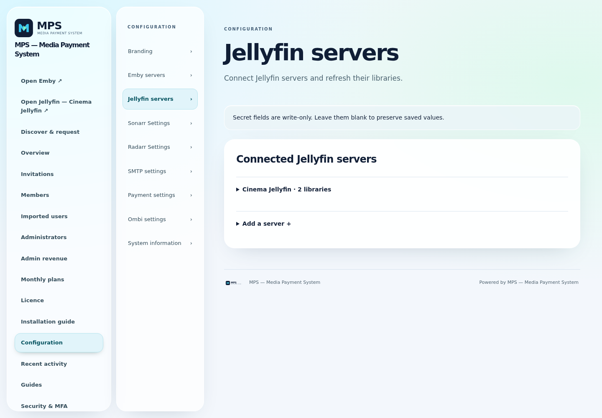

### Administrator Jellyfin guide

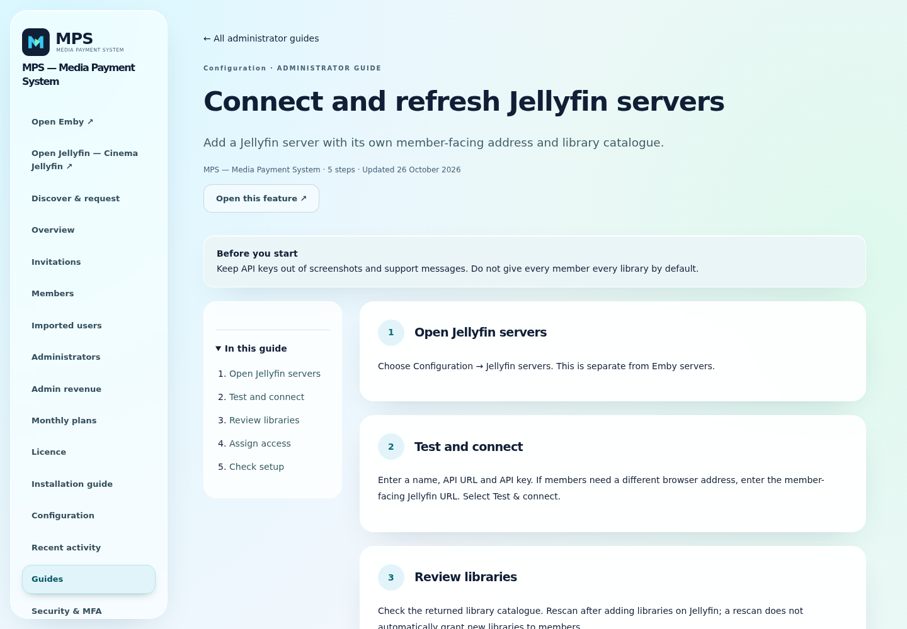

### Member Jellyfin guide

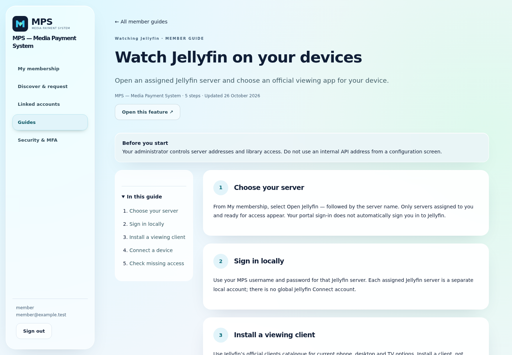

## Install

Choose your platform below. Windows and Linux downloads are the **new MPS 1.0.4 release**. Existing managed 1.0.3 installations upgrade in place; do not uninstall.

### Windows x64

1. [Download the Windows installer](https://github.com/matty03072/MPS-Media-Payment-System-Store/releases/download/installers-1.0.4/MPS-1.0.4-windows-x64-setup.exe).
2. Run the EXE as administrator. The installer is unsigned.
3. On a fresh interactive installation, choose **SQLite**, **Microsoft SQL Server** or **PostgreSQL**. External databases must already be provisioned; see the [setup requirements](https://github.com/matty03072/MPS-Media-Payment-System-Store/releases/tag/installers-1.0.4).
4. Open [http://localhost:8099](http://localhost:8099) on the installed computer and follow first-run setup.

For an existing installation, back up the complete data folder and run the new installer over the current copy. It retains the database, configuration and encryption key; it does not switch databases. SQLite normally uses `C:\ProgramData\MPS\data\members.sqlite3`.

### Linux — Ubuntu 24.04 x64

1. [Download the Linux archive](https://github.com/matty03072/MPS-Media-Payment-System-Store/releases/download/installers-1.0.4/MPS-1.0.4-linux-x64.tar.gz). Requires **systemd and CPython 3.12**.
2. Extract the archive, open a terminal in the extracted directory and run:

   ```bash
   sudo bash install.sh
   ```

3. Open [http://localhost:8099](http://localhost:8099) on the installed computer and follow first-run setup.

Back up the complete data folder before updating an existing installation. Standalone installers do not automatically configure a public domain, HTTPS or firewall access.

[1.0.4 release notes and SHA-256 checksums](https://github.com/matty03072/MPS-Media-Payment-System-Store/releases/tag/installers-1.0.4)

### umbrelOS

1. In umbrelOS, open **App Store → Community App Stores** (usually in the
   App Store menu).
2. Add `https://github.com/matty03072/MPS-Media-Payment-System-Store`.
3. Open **MPS — Media Payment System** and install **MPS — Media Payment System**.
4. Open the installed app from Umbrel. Unlock first-run setup with username
   `owner` and the app password shown by Umbrel.
5. Create your permanent owner account and enrol MFA with an authenticator.

## Umbrel deployment information
App ID: `memberspreview-members-portal`. Port: `18099` (must be unused).
Data is separate from any future official app. No live-site configuration,
production database, credentials or member records are included.

Use test integrations only. Default Umbrel authentication protects every route;
public invitations and external payment callbacks are not supported by this
default configuration. An official-store submission is under review; this community store is separate.

Application source is private. This repository contains store packaging, documentation and presentation assets only—not application source.

[Release notes](docs/RELEASE-1.0.4.md) · [Support](https://github.com/matty03072/MPS-Media-Payment-System-Store/issues)

Container checks do not constitute an umbrelOS installation test. The first
install, UI setup/MFA, reboot and backup/restore still need testing on your Umbrel.
Back up the entire app data folder, including all configuration. Do not assume automatic migration to a future production app ID.

## Update an existing Umbrel installation to 1.0.4

Use **Update** in Umbrel for your existing MPS installation. **Do not uninstall or delete the app to upgrade.** Back up the complete app data folder first. Existing app identity, data locations and licensing terms are unchanged.

## Installation activity

Free and licensed installations periodically report an installation identifier, app version and activity time to the publisher to measure active installations. No member details, media activity or service credentials are included. Reporting failures do not change free-tier access. See the [privacy notice](https://mediapaymentsystem.app/mps/privacy).

## Connected services

MPS includes separate Sonarr/Radarr settings, member download and import progress, optional Emby library scans, and administrator Media Managers for connected services. Configure your own services under **Configuration**; no live-site credentials are included.

## Application licensing

Ten enabled media members are free, including administrators with linked media identities. Larger installations require a GBP 10/month
unlock covering three applications. Back up the entire state directory before
updating; keep all existing app data. Without an unlock, excess member records
remain stored but only the ten oldest eligible enabled members retain MPS access.
Excess linked Emby access is disabled on downgrade and restored when licensing
and membership permissions allow it. Direct Ombi access is not disabled by MPS.
Paid access requires an online check after restart.
The existing [MPS no-resale licence](LICENSE) remains unchanged; paid membership operations are permitted. Application source is no longer publicly distributed. Previous licence grants remain unchanged.

[Licensing and upgrade guide](docs/APPLICATION-LICENSING.md).
[Purchase and signed-in support](https://mediapaymentsystem.app/mps).
Cancellation stops renewal at period end. Requests within 14 days of the latest
payment receive a full refund; paid access remains until period end.
